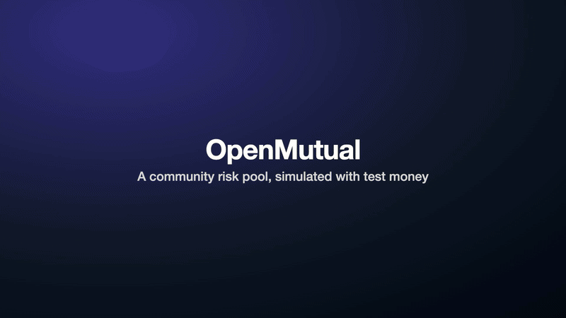

# OpenMutual (working name)



Project site: https://abozaralizadeh.github.io/OpenMutual/

Source available, free for non-commercial use (PolyForm Noncommercial 1.0.0). See [License](#license).

A simulation of a community risk pool on a blockchain. People buy small, rule based covers, other people back the pool that pays them, and the backers earn what's left after payouts. The rules and the money live in smart contracts, so no single company sits in the middle.

It runs with test money on a local test chain. Nothing here is insurance or an investment, nothing is for sale, and nobody can put real money in. Don't send money to anything claiming to be OpenMutual.

## What you can do in it

- Sign in with any email. The code shows on screen, and you get a test wallet with 10,000 test dollars.
- Back the pool, watch your share price move, and withdraw after a 7 day wait.
- Buy test cover: late flight (3 hours or more), rainy day (10 mm or more) or lost bag (members vote on the claim).
- Skip the simulated clock ahead and watch results come in and covers pay out by themselves.
- Become a member, vote on claims and on a few pool settings.
- See every pool number on a public page, checked against the chain.

## Quick install

You need Node.js 24 or newer. Foundry and the local chain come from npm, so there's nothing else to install.

```bash
git clone https://github.com/abozaralizadeh/OpenMutual.git openmutual
cd openmutual
npm install
npm run dev
```

Then open http://localhost:3417. The admin token prints in the terminal at the start.

`npm run dev` starts a fresh local chain, deploys the contracts, and runs the worker and the web app. `RESUME=1 npm run dev` keeps the chain and data from the last run. To change any setting, copy `.env.example` to `.env`.

## Run the tests

```bash
npm test
```

That builds the contracts and runs every suite. The browser tests need Google Chrome installed.

| Suite | Command | What it checks |
| --- | --- | --- |
| Contracts (Foundry) | `npm run test:contracts` | Pool, cover, results, votes, team wallet, plus random tests that the pool can always pay |
| Shared (vitest) | `npm run test:shared` | Local-only guards, fake world and sources, pricing, identity check, log file cap |
| Worker flows (vitest) | `npm run test:worker` | Whole flows on a real local chain: payout, refund, lying source, votes, withdrawals, rebuild from chain |
| Browser (Playwright) | `npm run test:e2e` | A new person backs the pool, buys cover, gets paid and withdraws. Plus sign-in, admin lock and phone screens |

If you change a contract and run one suite on its own, run `bash scripts/forge.sh build` and `npm run gen -w shared` first, or the suite tests the old build. `npm test` does this for you.

## Other commands

| Command | What it does |
| --- | --- |
| `npm run chain` | Only the local chain on port 8545 |
| `npm run deploy` | Build the contracts and deploy them to the local chain |
| `npm run simulate -- 12 20` | 12 simulated weeks, 20 covers a day. Writes [docs/SIMULATION-RESULTS.md](docs/SIMULATION-RESULTS.md). Takes about half an hour |

## What's faked

Nothing calls a paid or outside service. Each fake sits behind an interface, so a real one could replace it.

| Real thing | Fake used now | Where |
| --- | --- | --- |
| Public blockchain | Anvil, a local test chain. The code refuses anything else | `scripts/chain.sh`, `shared/src/chain.ts` |
| Stablecoin | TestUSD, worth nothing, with a faucet | `contracts/src/TestUSD.sol` |
| Flight and weather data | Three fake sources reading the same made up world, with late rates set from public statistics | `shared/src/sources/` |
| Identity check | Approves any name unless it contains "blocked" | `shared/src/identity.ts` |
| Email | The code shows on screen | `shared/src/mailer.ts` |
| Other members | Five pretend members who vote yes unless a claim says "fake" or "reject". Turn off with `SIMULATED_MEMBERS=false` | `worker/src/tick.ts` |
| People's own wallets | The server holds a test key for each person | `shared/src/app.ts` |
| Time | A simulated clock you can skip forward. Lock it with `PUBLIC_CLOCK=false` | Top of every page |

## Run it on a Linux server

For Ubuntu or Debian:

```bash
sudo bash setup_service.sh            # first run installs, later runs update and restart
sudo bash setup_service.sh --fresh    # start over with a new chain
journalctl -u openmutual-web.service -f
```

It sets up three services: `openmutual-chain`, `openmutual-worker` and `openmutual-web`. The worker and web app also write `logs/worker.log` and `logs/web.log`, capped at 15 MB each. The script makes `.env` on the first run with a random admin token and the clock locked. It's new, so expect rough edges.

## Please don't use it with real money

The contracts haven't been audited, the server holds everyone's keys, and the data sources are made up. The code refuses any chain that isn't local, and that's on purpose. See "What needs to change before real money" in [docs/DESIGN.md](docs/DESIGN.md).

## Project structure

```text
contracts/     Solidity contracts and Foundry tests
shared/        Domain logic for web and worker: chain, deploy, pricing, database, fakes
worker/        Background loop and the long simulation
web/           Next.js app and Playwright tests
config/        decisions.json, every setting you can tune in one place
scripts/       Chain, deploy, dev, tests
docs/          Design, flows, simulation results, screenshots, the demo GIF
site/          The project's one page website, with its images and demo video
demos/         Storyboards that re-record the demo and the site images
```

| Doc | What's in it |
| --- | --- |
| [docs/DESIGN.md](docs/DESIGN.md) | Architecture, contracts, data model, fakes, design choices |
| [docs/LOGICAL-FLOW.md](docs/LOGICAL-FLOW.md) | The main flows, step by step, with diagrams |
| [docs/SIMULATION-RESULTS.md](docs/SIMULATION-RESULTS.md) | A long run with made up people |

## Contributing

Issues and pull requests are welcome. For anything big, open an issue first so we can talk it through. Before you send a pull request, run `npm test` and make sure it passes. Keep everything local: no real keys, no public networks and no paid services. Contributions are accepted only under the terms in [CONTRIBUTING.md](CONTRIBUTING.md), which let the author relicense them, commercially too.

## License

Source available, free for non-commercial use (PolyForm Noncommercial 1.0.0). You can use, study, change and share the code for any non-commercial purpose. See [LICENSE](LICENSE).

Commercial use needs written permission. Ask through a GitHub issue.

The docs, screenshots and demo are under CC BY-NC 4.0, see [docs/LICENSE.md](docs/LICENSE.md). Third party packages keep their own licenses, see [THIRD_PARTY_NOTICES.md](THIRD_PARTY_NOTICES.md).
