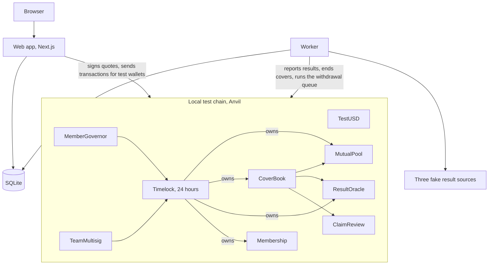

# Design

The design of the simulation as it's built. Some choices are still open and may change. The flows are in [LOGICAL-FLOW.md](LOGICAL-FLOW.md).

## Architecture



- **Contracts** hold the money and the rules. Nobody can take the pool's money or change a cover after it's sold. After deploy, no single key owns anything: every rule change goes through a 24 hour timelock.
- **Web app** is the screens. Each person signs in by email and gets a test wallet. The server sends transactions for that wallet, so nobody needs a wallet app. It also signs price quotes with the quoter key.
- **Worker** runs every few seconds. It asks three fake sources for results and reports each one from its own reporter key. It ends covers once results are final, works through the withdrawal queue, closes votes and copies chain events into the database.
- **Database** holds sign-ins, labels and copied events, so pages load fast. The chain is the source of truth for money. If the database is lost it can be rebuilt from the chain.

The web server holds the test wallet keys. That's fine for a simulation with worthless money and a terrible idea for real money, where people would hold their own keys. See "What needs to change before real money" below.

## Tech stack

| Part | Choice | Why |
| --- | --- | --- |
| Chain | Anvil, a local Ethereum test chain, chain id 31337 | Free, fast, no keys, nothing public. Code refuses any other address or chain id |
| Contracts | Solidity 0.8.28, Foundry, OpenZeppelin 5 | Common and well tested, with strong testing tools and audited building blocks |
| Web app | Next.js 16 with server actions, React 19, TypeScript | One language across app and worker, and no separate API to maintain |
| Chain access | viem | Standard and typed. ABIs are generated from the build |
| Worker | Node.js 24, TypeScript | Shares code with the web app |
| Database | SQLite, built into Node, in WAL mode | No extra service to run. Fine for one VM and a closed test |
| Results data | Three local fake sources | No paid or outside service. Real providers plug into the same interface later |
| Tests | Foundry, vitest, Playwright with the installed Chrome | Contract, unit, flow and browser tests |
| Hosting | One Linux VM with systemd | Matches the usual `setup_service.sh` setup |

SQLite and a local chain keep the simulation free of outside services. Nothing in this project runs on a public network.

## Project structure

```text
contracts/     Solidity contracts and Foundry tests
shared/        Domain logic used by web and worker: chain access, deploy, pricing, database, fakes
worker/        Background loop, seed script, the long simulation
web/           Next.js app and Playwright tests
config/        decisions.json, every setting you can tune in one place
scripts/       Start the chain, deploy, run everything, run all tests
docs/          Design, flows, simulation results, screenshots
site/          The project's one page website
setup_service.sh
```

## Contracts

| Contract | What it does |
| --- | --- |
| TestUSD | Test dollars with 6 decimals and a faucet of 10,000. Worth nothing |
| MutualPool | ERC-4626 vault. Backers get shares. Locks the full payout of every cover, counts prices as earned only when a cover ends, and has a FIFO withdrawal queue with a 7 day wait. Shares can't be moved between people |
| CoverBook | Products, covers and sales. Checks the signed quote, the sales cut-off, the event limit and that the pool has enough free money. Ends covers once a result is final |
| ResultOracle | Takes results from three reporters. Two must agree. Then there's a 1 hour window where the guardian can reject it |
| Membership | Who's a member and since when. Only the identity checker can add people |
| ClaimReview | Member vote on reviewed claims, such as a lost bag. You can't vote on your own claim |
| MemberGovernor | Member vote on a short list of settings. One member, one vote. Passed votes go through the timelock |
| TeamMultisig | Team wallet needing 2 of 3 signers. Can propose any change, through the same timelock |

Products, as set in `config/decisions.json`:

| Product | How it pays | Payout | Sales close |
| --- | --- | --- | --- |
| Late flight | Automatic, 180 minutes late or cancelled | 100 | 24 hours before |
| Rainy day | Automatic, 10 mm of rain or more | 50 | 48 hours before |
| Lost bag | Members vote on the claim | 200 | Any time, claim within 7 days |

Each event, such as one flight on one day, can't take more than 10% of the pool.

## Data model

### On chain

**MutualPool**

| Field | Meaning |
| --- | --- |
| totalAssets | Money in the pool, minus prices of covers that haven't ended |
| lockedCapital | Payouts held back for active covers |
| freeCapital | What can be withdrawn or used for new cover |
| unearnedPremiums | Prices of active covers, not yet counted as earnings |
| withdrawal queue | Backer, shares, when it can be paid |
| poolCap, withdrawalWait, memberRebateBps, paused | Settings |

**CoverBook**

| Field | Meaning |
| --- | --- |
| id | Cover number |
| holder | Member's wallet |
| productId | Which product |
| eventKey | Hash of product, reference and time. The reference is a hash too, so no flight number or place is readable on chain |
| eventTime | Departure, or the day for rain |
| premium, payout | What was paid and what's paid if it triggers |
| status | Active, ClaimOpen, PaidOut, Expired or Refunded |

No names, emails or anything personal go on chain. Only a wallet address and hashes.

### Off chain (SQLite)

| Table | Holds |
| --- | --- |
| users, sessions, login_codes | Email sign-in and test wallets |
| identity_checks | Results of the fake identity check |
| chain_events, covers | Copied chain events and a cover list for fast pages |
| labels | Readable names for event hashes, like the flight number |
| claim_evidence, proposal_notes | Text behind the hashes on chain |
| share_prices | Share price over time, for the chart |
| demo_results | Results set by hand from the Admin page |
| feedback, usage_counts | Feedback form and daily totals, no personal data |
| worker_state | Last block read |

## Local fakes

Nothing calls a paid or outside service. Each fake sits behind an interface, so a real one can replace it.

| Interface | Fake | Real one later |
| --- | --- | --- |
| `ResultSource` | Three sources reading the same made up world, plus the demo switch | Two or more flight data providers and a weather source |
| `IdentityProvider` | Approves any name, unless it contains "blocked", then adds the wallet as a member. One membership per name and country | A licensed identity check provider |
| `Mailer` | Shows the sign-in code on screen. No email goes out | An email service |
| `PricingEngine` | Risk table, or the table blended with past results | Same, reviewed by an actuary |
| Simulated members | Five pretend members vote yes, unless the text says "fake" or "reject" | Real members |

## Pricing

Price = payout × chance × (1 + margin), rounded up to whole cents. The margin is 60%.

| Risk group | Chance | Price for a payout of 100 |
| --- | --- | --- |
| Low | 1% | 1.60 |
| Middle | 2.5% | 4.00 |
| High | 5% | 8.00 |

Rainy day uses a 12% chance, so 9.60 for a payout of 50. Lost bag uses 2%, so 6.40 for a payout of 200. Both are set in `shared/src/pricing.ts`, and the fake world is tested to match them.

The flight chances come from public delay statistics. About 3% of US flights and about 1.5 to 2% of UK and European flights are 3 or more hours late or cancelled.

## Screens

| Screen | What it does |
| --- | --- |
| Home | Explains the idea, says it's a simulation, shows the simulated clock |
| Sign in | Email and a 6 digit code, shown on screen. Makes a test wallet and gives it 10,000 test dollars |
| Get cover | Pick a flight, a day of weather or a lost bag cover, see the price and rules, confirm |
| My covers | Each cover's status and result. File a lost bag claim |
| Back the pool | Deposit, see shares and earnings, ask to withdraw, see the queue |
| Numbers | Public totals, a balance check, share price chart, recent covers |
| Community | Become a member, vote on claims and settings, suggest a change |
| Admin | Locked by a token. Set results by hand, pause, schedule a setting change through the team wallet, see feedback and usage |
| Feedback, Terms, Privacy | Feedback form and draft test terms |

## Operations

- Services: `openmutual-chain`, `openmutual-worker` and `openmutual-web`, each readable with `journalctl -u <name>.service -f`.
- `setup_service.sh` installs everything on the first run, then updates and restarts on later runs.
- The worker and web app also write to `logs/worker.log` and `logs/web.log`, 5 MB per file with 2 old files kept, so at most 15 MB each. Copy the `logs` folder to local for debugging. The chain runs quietly and only logs to journalctl.
- The chain keeps its state in `data/chain-state.json`, so a restart doesn't lose anything.
- Only `.env.example` is in the repo. The real `.env` is made on the VM and never committed.

## Design choices

Why the simulation works the way it does.

### What taking part means: two roles

Members buy cover. Backers put in money and earn. **Why:** something has to stand behind the risk, and the earning in insurance comes from taking that risk. One person can do both, so everyone can be on the earning side.

### Earnings come from leftover prices

Earnings are prices minus payouts, shared by pool share. A price counts as earned only when its cover ends. **Why:** this is real insurance income, and it's simple to explain. New backers' money never pays old backers, which is what would make it a scam. Counting a price only when the cover ends means a backer can't join, collect a share of fresh prices and leave before the risk is over. There's no promised return, and backers can lose money.

### Use a real blockchain

**Why:** the idea is that no single company sits in the middle. Public contracts let anyone check the rules and the money. A normal database would be easier, but it would just be another company asking for trust. The downside is that it brings crypto rules with it.

### Flight delay as the first product

**Why:** the result is a fact, so nobody has to judge a claim. Results arrive in days, so we learn fast. The downside is that bad weather can delay many flights at once, which is why there's an event limit, and the data source becomes a trusted party.

### Full reserve for every cover

Each cover locks its full payout until it ends. **Why:** the pool can never owe more than it holds. The downside is lower returns than a normal insurer. That's the right trade while the pricing is unproven.

### 7 day wait on withdrawals, with no cancel

**Why:** without it, backers could leave right before a known bad event and leave the losses to others. Shares are valued when the wait ends, so someone who asks to leave still shares losses during the wait. No cancel stops people from queuing early "just in case".

### No token

Shares can't be moved between people. **Why:** a tradable token invites speculation, makes the investment rules harder and adds nothing the product needs.

### Test money only, on a local chain

**Why:** it proves everything without any legal or money risk, and without anyone mistaking it for real cover. The product calls it a simulation and avoids the word "insurance" for what it sells.

### Three reporters, two must agree, plus a 1 hour window to reject

**Why:** a single trusted reporter is a single point of failure. The real version needs two or more independent data providers. The guardian can only reject a result, not set one.

### Contracts can't be upgraded, and a timelock owns them

Fixes mean a new deployment. Every setting change waits 24 hours, so people can see it coming and leave if they want. **Why:** upgradable contracts let whoever holds the key change the rules, which goes against the idea.

### One member, one vote, on a short list

Members vote on claims and on three settings: the pool cap, the withdrawal wait and the share given back to members. Everything else stays with the team. **Why:** that's how a mutual works, and it stops the biggest backers from running everything. Voting by money would hand control to the richest backers.

## What needs to change before real money

- Independent audit of the contracts
- People hold their own keys, and the server never does
- Two or more real flight data providers, on contracts that allow payout use
- Real identity checks, sanctions screening and a licensed way to pay in and out
- Team signers held by different real people
- Pricing reviewed by an actuary
- Whatever the law requires where it runs
