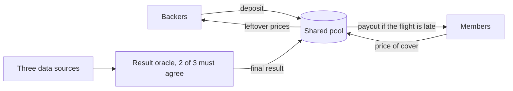
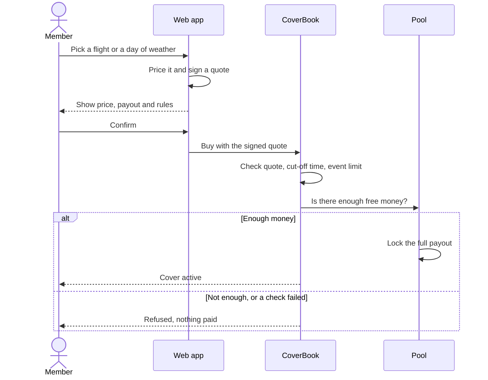
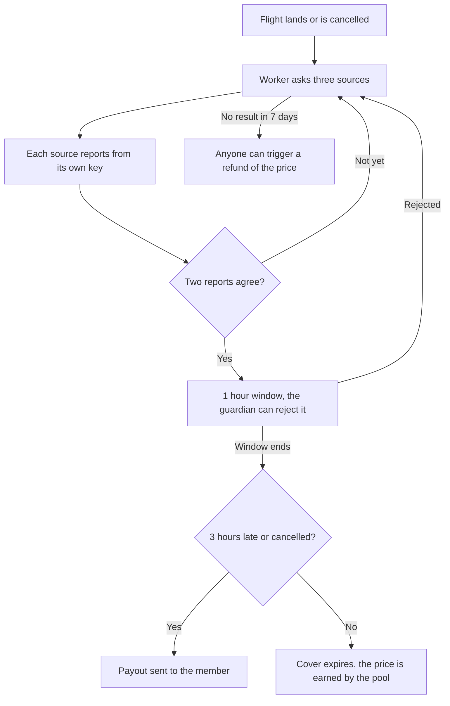
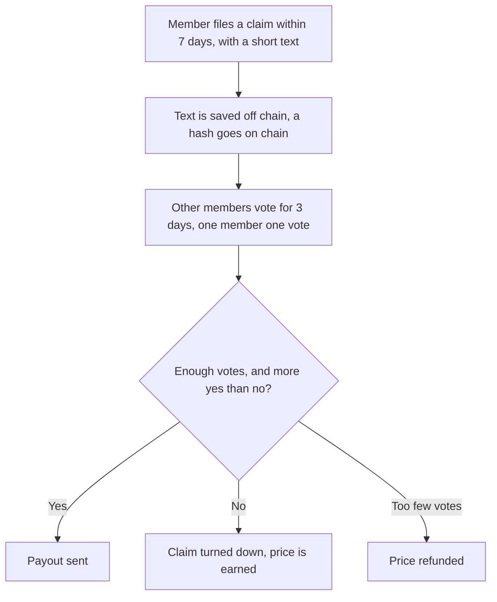
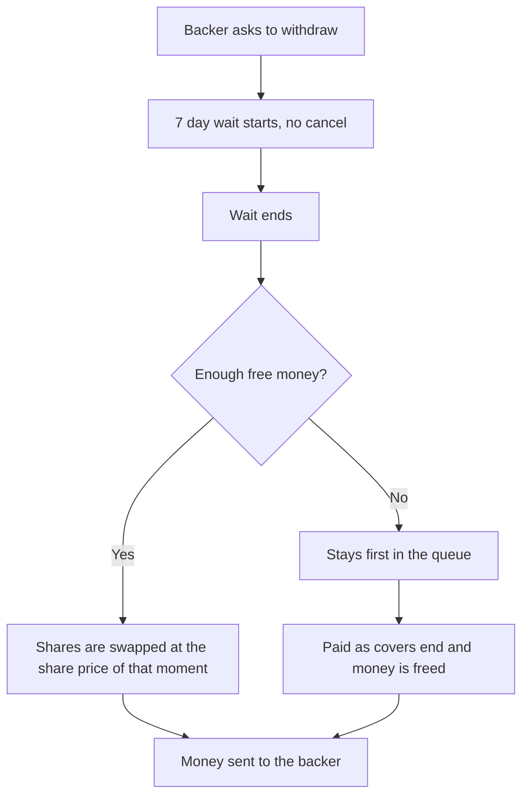
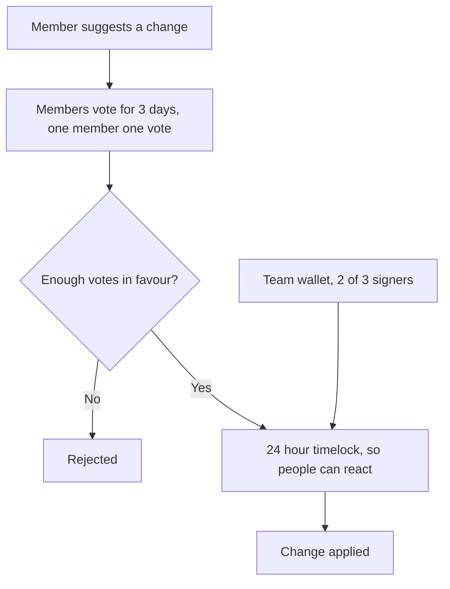

# Logical flows

The main flows of the simulation as built. Numbers use test money. See [DESIGN.md](DESIGN.md) for the parts named here.

## The big picture

## A worked example

One late flight cover has a price of 4 and a payout of 100. Pricing assumes a 2.5% chance of a payout for a typical flight, plus a 60% margin: 100 × 2.5% × 1.6 = 4.

| What happens | Pool's money | Backers |
| --- | --- | --- |
| Flight on time | Keeps the 4 | Earn 4, shared by pool share |
| Flight late | Pays 100, with 4 from the price and 96 from backers | Lose 96, shared by pool share |

Over 100 covers, that's 400 in prices and about 2.5 payouts, or 250. About 150 is left for backers. That's an expected average, so a bad month can lose money.

## 1. Signing in

1. The person types an email.
2. A 6 digit code is "sent". In the simulation it's shown on screen, since no email service is used.
3. They type the code. On first sign-in, the server makes a test wallet for them and gives it 10,000 test dollars.

## 2. Backing the pool

1. The backer reads the risk note, which says backers can lose money.
2. They choose an amount and deposit it.
3. The pool gives them shares at the current share price.
4. Their shares now rise or fall with the pool's results.

## 3. Buying cover

Checks:

- Flight sales close 24 hours before departure, and rain sales 48 hours before the day, so nobody buys cover for something they already know is in trouble.
- One event can't take more than 10% of the pool, so one bad flight or storm can't hit too hard.
- The quote is signed by the quoter key, used once and expires quickly, so nobody can make up a low price.

## 4. Getting a result and ending cover

Nobody judges the claim, and the member doesn't file anything. The result comes from the data, and the contract applies the rule.

For a demo, the Admin page can set a result by hand. That feeds the same three sources, so it still goes through the same 2 of 3 check and the 1 hour window.

## 5. Lost bag: a claim members review

Only people who were members before the claim was filed can vote, and nobody votes on their own claim. In the simulation, five pretend members vote yes unless the text says "fake" or "reject".

## 6. Earning and withdrawing

Earnings aren't paid out on a schedule. They show up as a higher share price, and the backer collects them on withdrawal.

The wait stops backers from pulling out just before a known bad event, such as a big storm. Shares are valued at the end of the wait, so a backer who asks to leave still shares any losses that happen during it.

## 7. If there isn't enough money

The simulation avoids this by design.

1. Every cover locks its full payout when sold.
2. Locked money can't be withdrawn.
3. When there isn't enough free money, new sales stop.
4. Backers can add money, which restarts sales.

So the pool can always pay what it has promised. Backers can still lose money, but members can't be left unpaid.

## 8. Changing a setting

Members can only vote on three settings: the pool cap, the withdrawal wait, and the share of each price given back to members with no payout. The team can change anything, but only through the same 24 hour delay.

## 9. When something goes wrong

| Problem | What happens |
| --- | --- |
| Data sources are down | Worker keeps asking. After 7 days with no result, the member can get a refund |
| One source reports something wrong | It needs a second source to agree, so one wrong source can't decide alone |
| Two sources agree on something wrong | The guardian can reject it in the 1 hour window |
| Bug found in a contract | The guardian pauses new sales and deposits. Withdrawals and payouts stay open |
| A reporter key is stolen | One key alone can't decide a result. The team swaps the key through the timelock |
| Flight changes date or number | The cover stays linked to the original flight. Cancelled and rebooked counts as cancelled |
